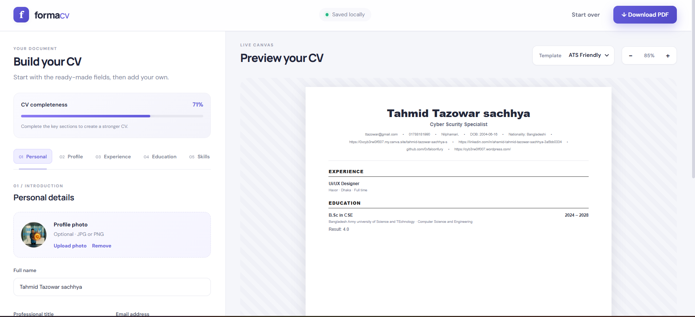
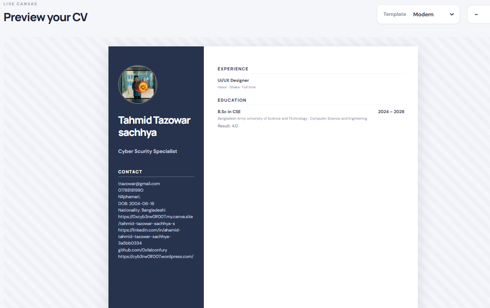
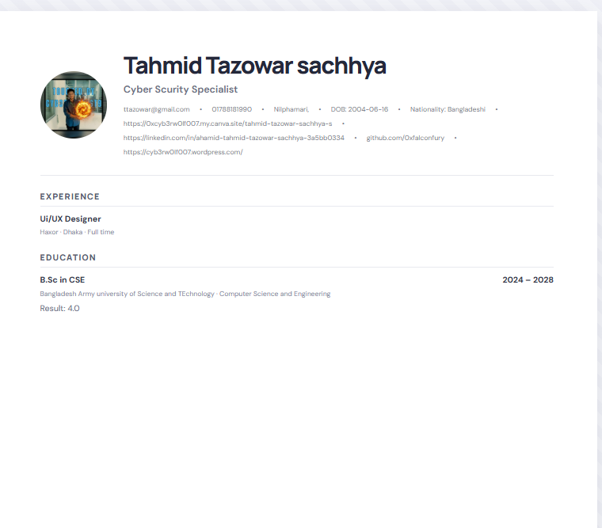

# FormaCV — Professional Resume Builder

FormaCV is a modern, fully responsive, client-side CV/Resume builder. Built with vanilla HTML, CSS, and JavaScript, it provides a seamless, real-time editing experience with a live preview and multiple professional templates. No backend or build tools are required—just pure, fast, and private frontend technology.

## ✨ Key Features

- **Live Preview:** See your CV take shape instantly as you type.
- **6 Professional Templates:** Choose from Minimal, Modern, Corporate, Creative, ATS Friendly, and Executive layouts.
- **Comprehensive Sections:** Dedicated fields for Personal Details, Profile, Work Experience, Education, Skills, Projects, Certifications, and more.
- **Custom Fields:** Create your own sections (e.g., Publications, Volunteering) with custom labels, text types, and visibility toggles.
- **Dynamic Repeater Fields:** Easily add or remove multiple experiences, education entries, and projects.
- **Profile Photo Upload:** Optional photo upload with automatic size and format validation.
- **Auto-Save Feature:** Your data is automatically saved to your browser's `localStorage` as you type. No account required.
- **PDF Export:** Download your finished CV as a high-quality, print-ready A4 PDF using the native browser print dialog.
- **Enhanced UI/UX:** Features floating action buttons, smooth transitions, ripple click effects, hover states, and mobile-friendly edit/preview tabs.
- **Privacy First:** 100% client-side. Your data never leaves your browser.

## 🚀 Getting Started

Since FormaCV is a static web application, you don't need to install any dependencies or run a build step.

### Option 1: Open Directly
1. Download or clone this repository.
2. Navigate to the project folder.
3. Double-click `index.html` to open it in any modern web browser.

### Option 2: Run a Local Server (Recommended)
For a better development experience and to ensure all features (like font loading) work perfectly, run a local server:

```bash
# If you have Python installed:
python -m http.server 5500

# If you have Node.js installed:
npx serve
```
Then visit `http://localhost:5500` in your browser.

## 📂 Project Structure

```text
FormaCV/
├── index.html              # Main application interface
├── README.md               # Project documentation
├── css/
│   ├── style.css           # Core UI, layout, animations, and design tokens
│   ├── templates.css       # Specific styling for the 6 CV templates
│   └── responsive.css      # Mobile and tablet media queries
└── js/
    ├── app.js              # Core application logic and state management
    ├── editor.js           # Dynamic form rendering and event handling
    ├── pdf.js              # Native PDF export logic
    ├── storage.js          # LocalStorage save/load functionality
    └── templates.js        # HTML generation for the live preview
```

## Images 





## 🛠️ Technology Stack

- **HTML5:** Semantic and accessible markup.
- **CSS3:** Custom properties (variables), Flexbox, CSS Grid, animations, and media queries. No external frameworks used.
- **Vanilla JavaScript (ES6+):** Modular pattern, event delegation, and DOM manipulation.
- **Google Fonts:** Manrope, DM Sans, and Playfair Display for professional typography.

## 📄 Exporting to PDF

1. Click the **Download PDF** button in the top right corner (or the floating action button on mobile).
2. In the browser's print dialog, change the destination to **"Save as PDF"**.
3. Set the paper size to **A4**.
4. *(Optional)* Enable **"Background graphics"** to ensure the dark sidebar in the Modern template and other colored elements print correctly.

## 🔒 Data & Privacy

All data entered into FormaCV is stored locally in your browser using the `localStorage` API. There are no backend servers, databases, or analytics tracking. 

- To clear your data, click the **Start over** button in the top navigation.
- Clearing your browser's site data will also remove the saved CV.

## 🌐 Hosting

Because this is a static website, it can be hosted for free on various platforms:
- **GitHub Pages:** Push to a repository and enable Pages in settings.
- **Netlify / Vercel:** Drag and drop the project folder into their dashboard.
- **Any standard web host:** Upload the files via FTP.

## 🤝 Contributing

Contributions, issues, and feature requests are welcome! 
1. Fork the project.
2. Create your feature branch (`git checkout -b feature/AmazingFeature`).
3. Commit your changes (`git commit -m 'Add some AmazingFeature'`).
4. Push to the branch (`git push origin feature/AmazingFeature`).
5. Open a Pull Request.

## 📝 License

This project is open-source and available under the [MIT License](https://opensource.org/licenses/MIT). You are free to use, modify, and distribute it for personal and commercial projects.
